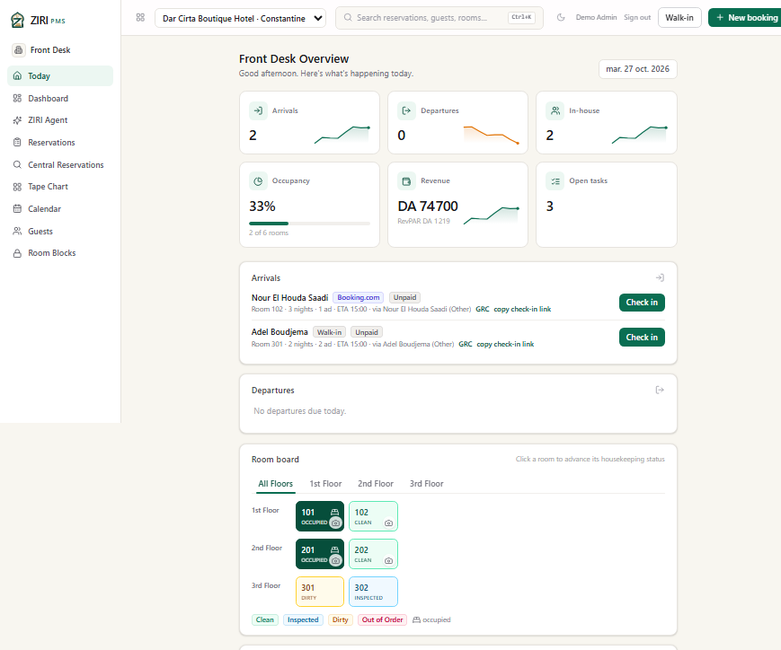
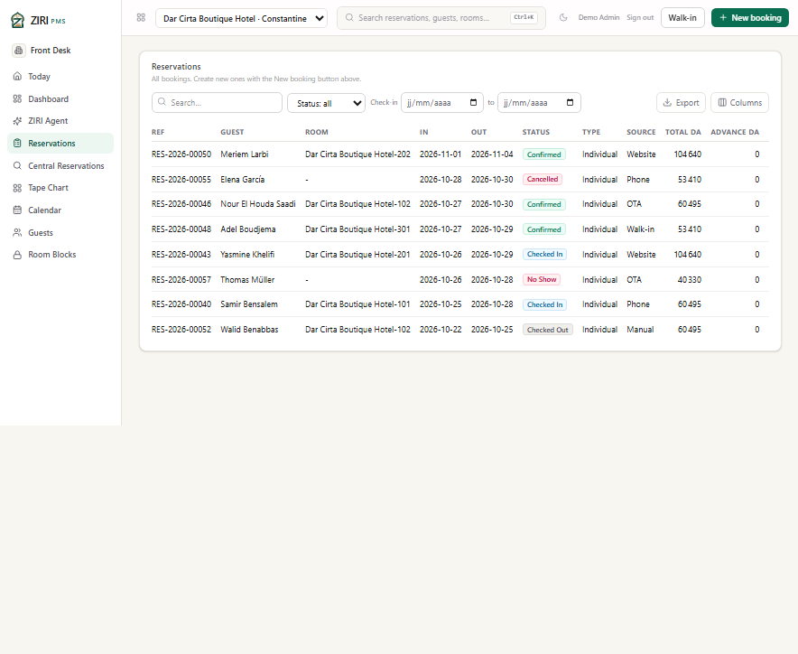
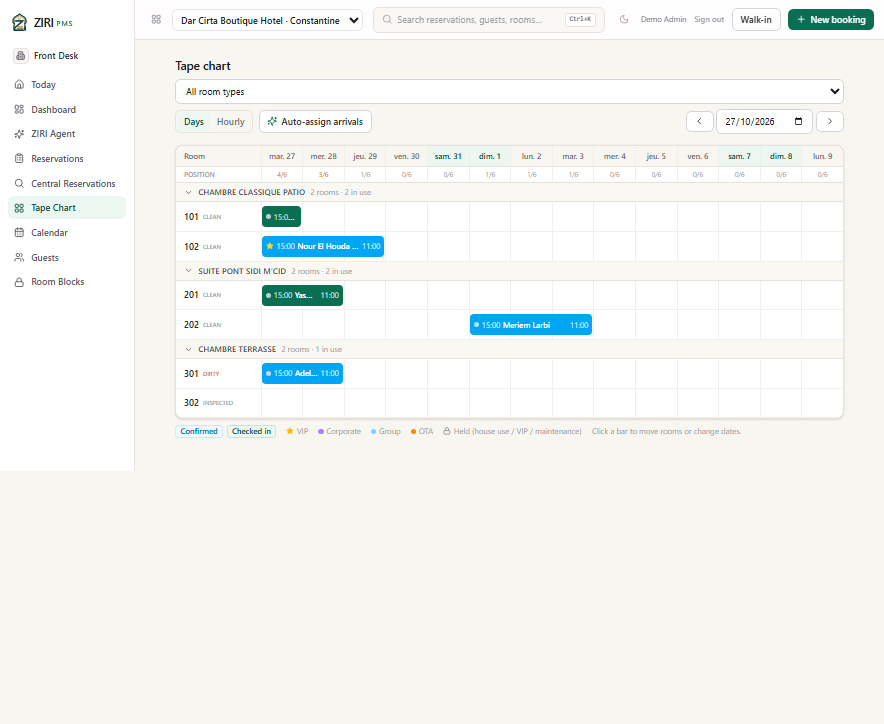
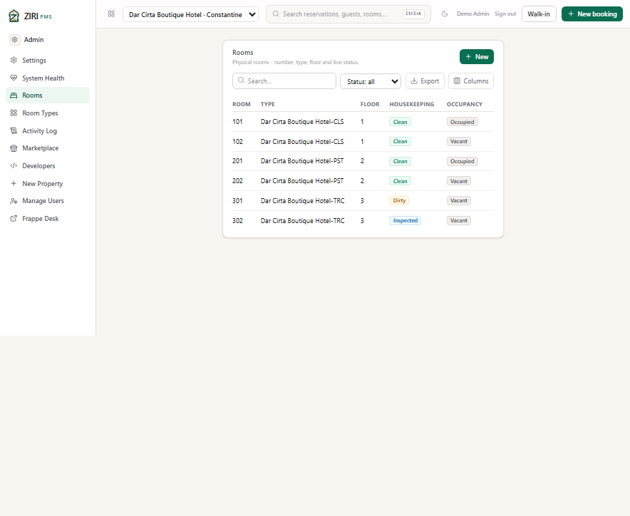
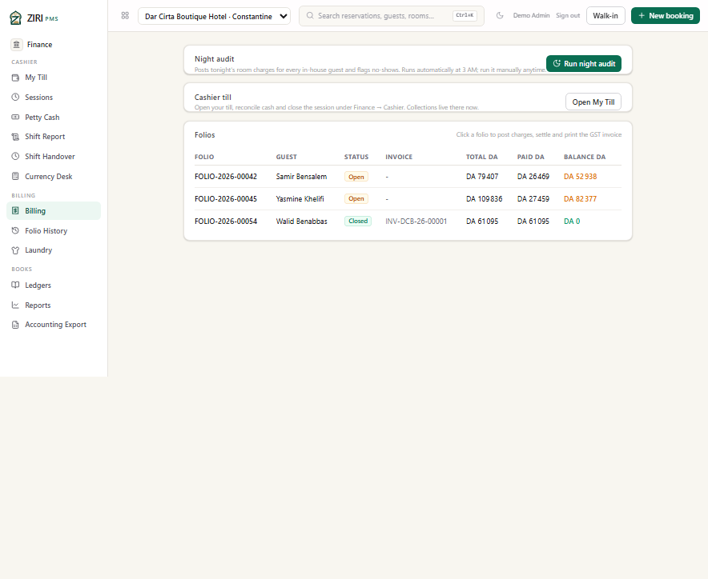

# Dar Cirta Boutique Hotel — Constantine

> **Fictional demo scenario.** The property, its staff, guests, rates and
> reservations are synthetic. Email addresses use the reserved `.example`
> domain. No production data or real personal information is used.

**Profile:** boutique maison above the Rhumel gorges, with a patio, a library
and a table d'hôtes. **City:** Constantine · **Currency:** DZD · **Demo
inventory:** 6 rooms across 3 room types · **Demo data:** 8 guests, 8
reservations, 3 folios, 3 open housekeeping tasks.

This scenario is deliberately smaller and more expensive than the Alger city
hotel. It shows how the same front desk handles a high-rate, low-room-count
property where every arrival matters and the suite is the anchor of the day.

*Today: 2 arrivals, 2 in-house guests, 33% occupancy, DA 74,700 posted revenue
and DA 1,219 RevPAR. The suite and one classic room are occupied; the dirty
terrace room is waiting for the walk-in arrival.*

## The scenario

**Nour El Houda Saadi** arrives from Booking.com into room 102 for three
nights, travelling alone. **Adel Boudjema** walks in for two nights in room
301, the terrace room, which housekeeping has marked dirty — the check-in
button and the room board together make that visible before he is assigned.

**Samir Bensalem** (room 101, phone booking) and **Yasmine Khelifi** (room 201,
direct website booking) are in house. The suite is the highest-value folio of
the day. **Walid Benabbas** checked out earlier in the week, and his closed,
paid folio carries invoice `INV-DCB-26-00001`.

## What the screenshots show

### Reservations

Eight stays across the full status range. The dates and totals make the
property's positioning obvious: the suite sells at DA 32,000 per night before
tax, so a three-night stay is a five-figure folio.

### Tape chart

Room 201 (Suite Pont Sidi M'Cid) is occupied by Yasmine; room 202 holds
Meriem Larbi's later booking. Room 301 is the walk-in terrace room and is dirty
on the day of arrival. The chart keeps the room-type groups — Classique Patio,
Suite Pont Sidi M'Cid, Chambre Terrasse — readable at a glance.

### Rooms

The housekeeping state is the story: 101 and 201 occupied and clean, 102 and
202 vacant and clean, 301 dirty, 302 inspected. The room-type column points at
the sellable category, not a free-text label.

### Billing

| Folio | Guest | Status | Total | Paid | Balance |
|---|---|---|---:|---:|---:|
| FOLIO-2026-00042 | Samir Bensalem | Open | DA 79,407 | DA 26,469 | DA 52,938 |
| FOLIO-2026-00045 | Yasmine Khelifi | Open | DA 109,836 | DA 27,459 | DA 82,377 |
| FOLIO-2026-00054 | Walid Benabbas | Closed | DA 61,095 | DA 61,095 | DA 0 |

The two open folios carry partial payments; the closed one carries invoice
`INV-DCB-26-00001`. A cashier can rehearse settlement on either open folio
without touching a real guest's bill.

## Demo data in this property

| Room type | Code | Base rate / night | Rooms |
|---|---|---:|---:|
| Chambre Classique Patio | CLS | DA 18,500 | 2 |
| Suite Pont Sidi M'Cid | PST | DA 32,000 | 2 |
| Chambre Terrasse | TRC | DA 24,500 | 2 |

The same Algerian country pack is active: DZD, Africa/Algiers, French locale,
9% GST, a DA 100 per-person per-night *taxe de séjour*, and a two-day free
cancellation window. The difference is commercial, not technical.

## Provenance

Captured on 27 October 2026 from the isolated staging deployment, signed in as
the seeded staging administrator. The four demo properties share one staging
database; production data was never read or copied. See
[all four scenarios](README.md) and the
[licensing notes](../algeria/LICENSING.md).
