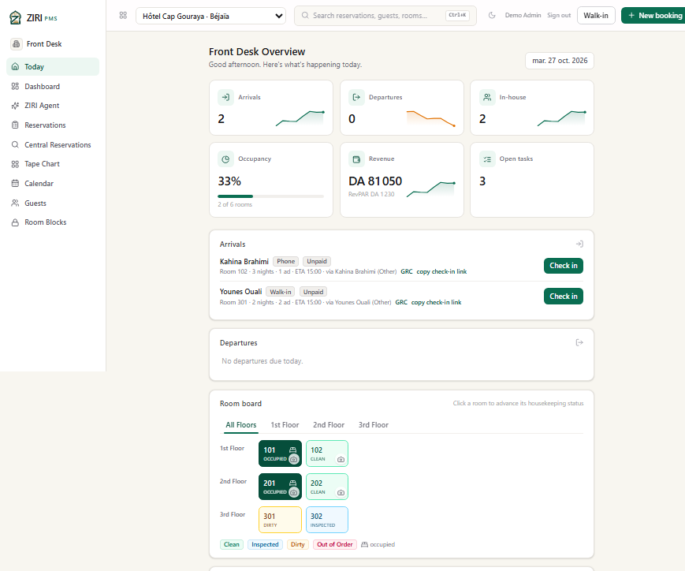
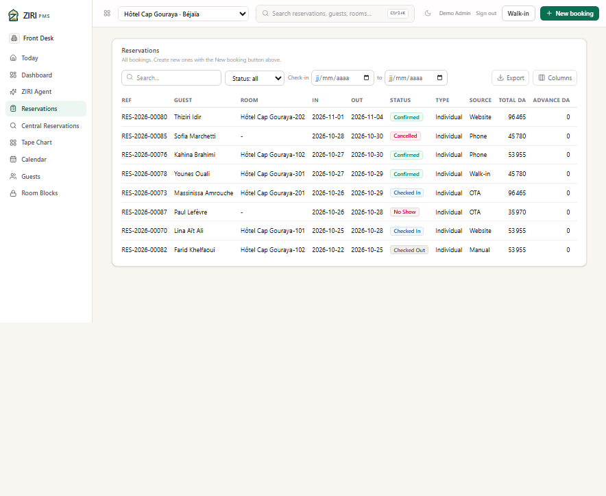
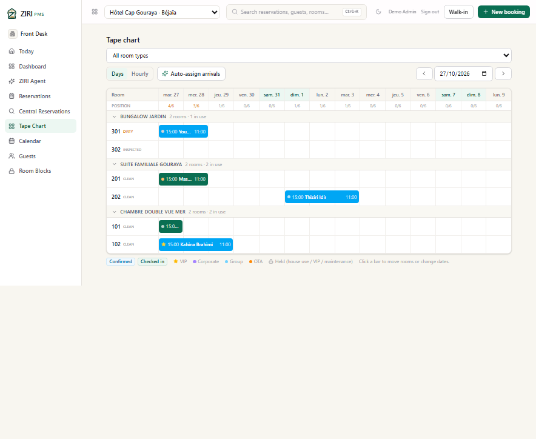
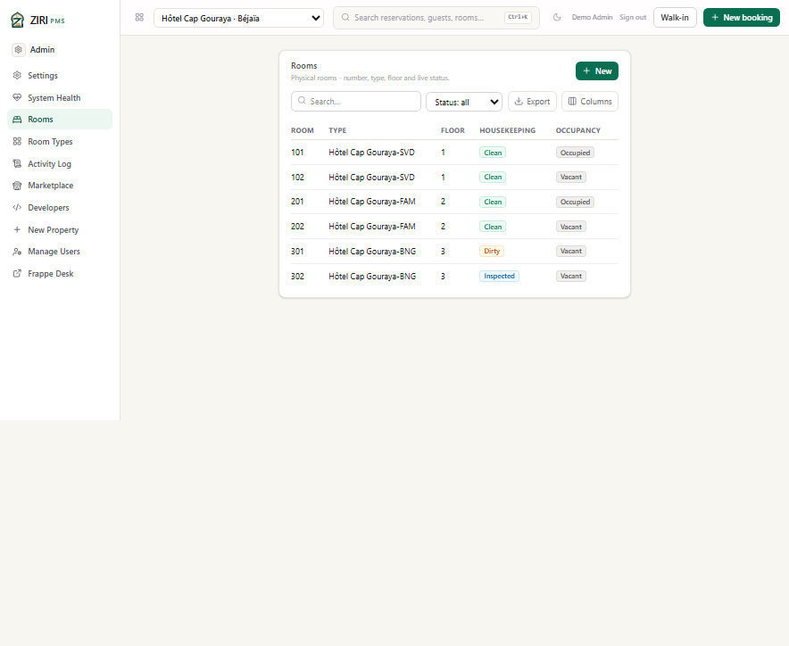
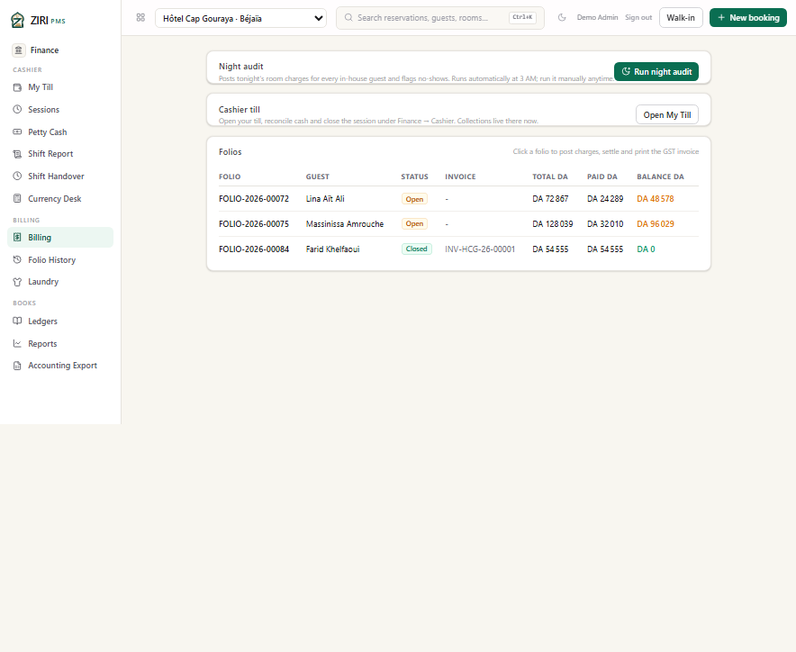

# Hôtel Cap Gouraya — Béjaïa

> **Fictional demo scenario.** The property, its staff, guests, rates and
> reservations are synthetic. Email addresses use the reserved `.example`
> domain. No production data or real personal information is used.

**Profile:** family four-star hotel on the Corniche at Aiguades, under Mount
Gouraya, with a pool, a private beach and a seafood restaurant. **City:**
Béjaïa · **Currency:** DZD · **Demo inventory:** 6 rooms across 3 room types ·
**Demo data:** 8 guests, 8 reservations, 3 folios, 3 open housekeeping tasks.

This scenario shows a leisure property with families, a bungalow product and a
higher average folio than the city hotels. It also demonstrates how the tape
chart handles a four-person suite and a garden bungalow side by side.

*Today: 2 arrivals, 2 in-house guests, 33% occupancy, DA 81,050 posted revenue
and DA 1,230 RevPAR — the highest revenue of the four scenarios, driven by the
family suite.*

## The scenario

**Kahina Brahimi** arrives from a phone booking into room 102 for three nights,
travelling alone. **Younes Ouali** walks in for two nights in room 301, the
garden bungalow, for a couple. **Lina Aït Ali** (room 101, direct website) and
**Massinissa Amrouche** (room 201, OTA) are in house; Massinissa's family suite
is the day's largest open balance.

**Farid Khelfaoui** checked out earlier in the week. His closed folio carries
invoice `INV-HCG-26-00001`, giving the cashier a settled example alongside the
two open family balances.

## What the screenshots show

### Reservations

The list mixes a family booking, a solo phone booking and a walk-in. The
`Type` column stays `Individual` for these records; group and corporate
bookings use the dedicated flows. Totals include the suite's two adults and
two children.

### Tape chart

The Bungalow Jardin, Suite Familiale Gouraya and Chambre Double Vue Mer groups
are visible in one view. Room 301 is dirty on arrival day, room 201 is occupied
by the family, and room 202 holds Thiziri Idir's future booking.

### Rooms

The physical-room view separates housekeeping status from occupancy status:
301 is dirty but vacant, 302 is inspected, 101 and 201 are occupied. The
housekeeping team can work from this list without reading the reservation.

### Billing

| Folio | Guest | Status | Total | Paid | Balance |
|---|---|---|---:|---:|---:|
| FOLIO-2026-00072 | Lina Aït Ali | Open | DA 72,867 | DA 24,289 | DA 48,578 |
| FOLIO-2026-00075 | Massinissa Amrouche | Open | DA 128,039 | DA 32,010 | DA 96,029 |
| FOLIO-2026-00084 | Farid Khelfaoui | Closed | DA 54,555 | DA 54,555 | DA 0 |

The family suite's folio is the largest in the set. The closed folio carries
invoice `INV-HCG-26-00001`; the two open folios show how partial payments are
tracked against a stay.

## Demo data in this property

| Room type | Code | Base rate / night | Rooms |
|---|---|---:|---:|
| Chambre Double Vue Mer | SVD | DA 16,500 | 2 |
| Suite Familiale Gouraya | FAM | DA 29,500 | 2 |
| Bungalow Jardin | BNG | DA 21,000 | 2 |

The property uses the same Algerian country pack: DZD, Africa/Algiers, French
locale, 9% GST, a DA 100 per-person per-night *taxe de séjour*, and a two-day
free cancellation window.

## Provenance

Captured on 27 October 2026 from the isolated staging deployment, signed in as
the seeded staging administrator. The four demo properties share one staging
database; production data was never read or copied. See
[all four scenarios](README.md) and the
[licensing notes](../algeria/LICENSING.md).
