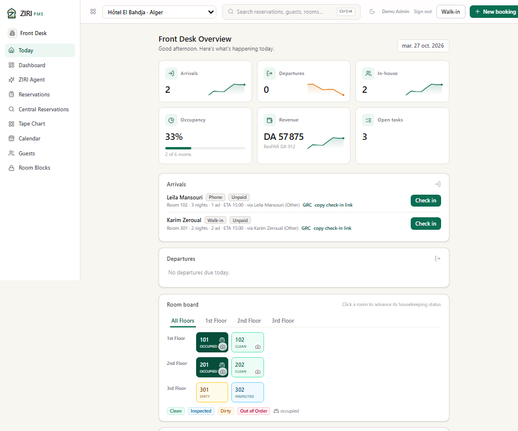
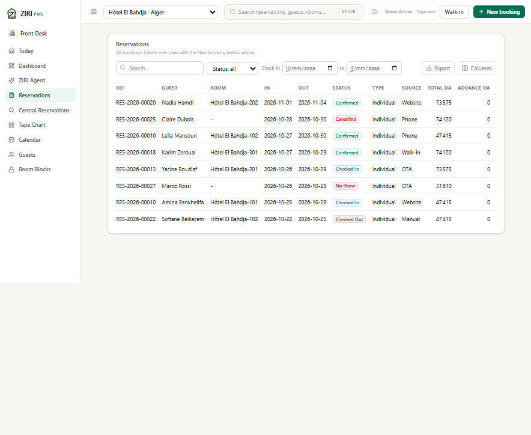
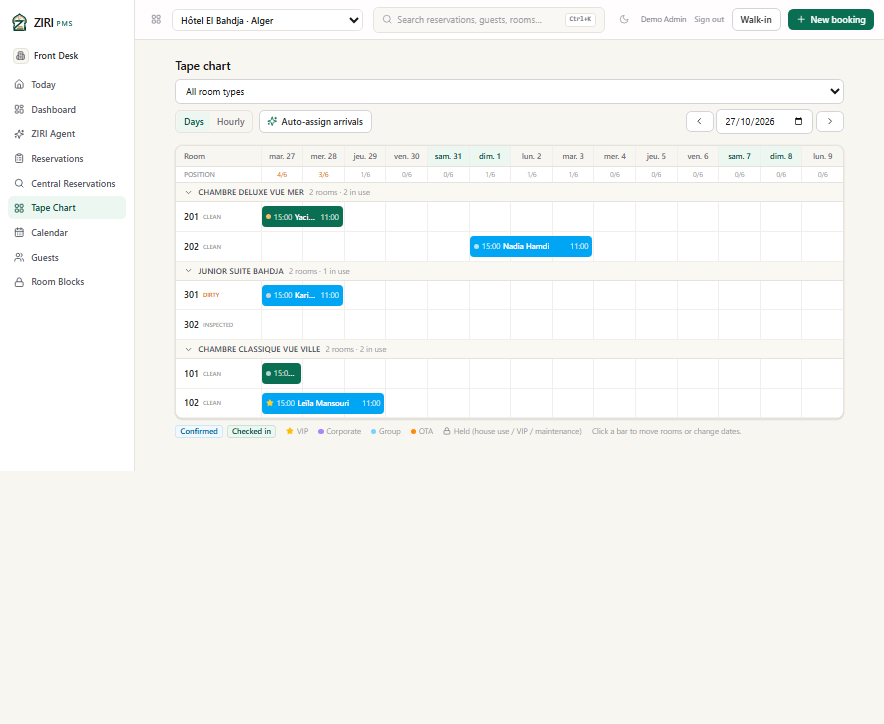
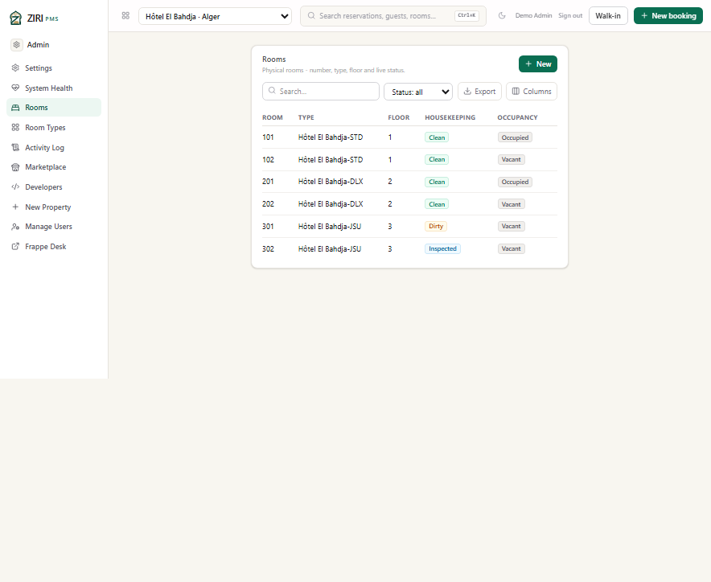
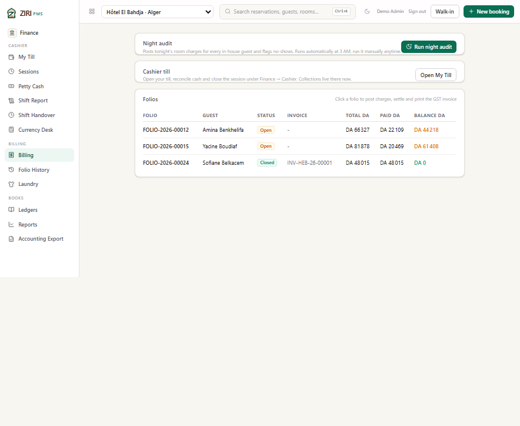

# Hôtel El Bahdja — Alger

> **Fictional demo scenario.** The property, its staff, guests, rates and
> reservations are synthetic. Email addresses use the reserved `.example`
> domain. No production data or real personal information is used.

**Profile:** four-star city hotel on the Algiers waterfront, a short walk from
the Grande Poste. **City:** Alger · **Currency:** DZD · **Demo inventory:** 6
rooms across 3 room types · **Demo data:** 8 guests, 8 reservations, 3 folios,
3 open housekeeping tasks.

This scenario exercises the classic city-hotel day: two arrivals to check in,
two guests already in house, a mix of direct, OTA, phone and walk-in business,
and folios in three different states — partially paid, fully paid, and open.

*Today: 2 arrivals, 2 in-house guests, 33% occupancy, DA 57,875 posted revenue,
and a room board with two occupied rooms, one dirty room and one inspected
room. The three open housekeeping tasks are the day's cleaning load.*

## The scenario

The morning starts with **Leïla Mansouri** arriving from a phone booking into
room 102 for three nights, and **Karim Zeroual** walking in for two nights in
room 301. Both are pay-at-hotel, so neither has an advance payment yet.

**Amina Benkhelifa** (room 101, direct website booking) and **Yacine Boudiaf**
(room 201, OTA) are already in house. Amina leaves tomorrow; her folio shows a
partial payment and an outstanding balance, which the front desk can settle at
checkout. A previous stay by **Sofiane Belkacem** is already closed and
invoiced, giving the cashier a completed example next to the two open folios.

## What the screenshots show

### Reservations

Eight reservations cover every operational state the front desk works with:
Confirmed, Checked In, Checked Out, Cancelled and No Show. Source, stay dates,
room and total are visible without opening a record.

### Tape chart

The chart has 6 rooms over 14 days. Room 201 (Deluxe) is occupied by Yacine,
room 202 holds Nadia Hamdi's future booking, room 301 (Junior Suite) holds
Karim's arrival, and the two Classic rooms are occupied by Amina and Leïla.
Housekeeping state is printed on each room line, so the front desk can see that
301 is dirty before checking Karim in.

### Rooms

The physical-room list is the housekeeping view: 101 and 201 occupied, 102 and
202 vacant and clean, 301 dirty, 302 inspected. The room type is the inventory
record the reservation points at.

### Billing

Three folios show the money story:

| Folio | Guest | Status | Total | Paid | Balance |
|---|---|---|---:|---:|---:|
| FOLIO-2026-00012 | Amina Benkhelifa | Open | DA 66,327 | DA 22,109 | DA 44,218 |
| FOLIO-2026-00015 | Yacine Boudiaf | Open | DA 81,878 | DA 20,469 | DA 61,408 |
| FOLIO-2026-00024 | Sofiane Belkacem | Closed | DA 48,015 | DA 48,015 | DA 0 |

The closed folio carries invoice `INV-HEB-26-00001`, so the GST invoice path is
represented by a real posted document rather than an empty placeholder.

## Demo data in this property

| Room type | Code | Base rate / night | Rooms |
|---|---|---:|---:|
| Chambre Classique Vue Ville | STD | DA 14,500 | 2 |
| Chambre Deluxe Vue Mer | DLX | DA 22,500 | 2 |
| Junior Suite Bahdja | JSU | DA 34,000 | 2 |

The property is configured with a DZD currency, Africa/Algiers time zone, French
locale, 9% GST, a DA 100 per-person per-night *taxe de séjour*, and a two-day
free-cancellation window.

## Provenance

Captured on 27 October 2026 from the isolated staging deployment, signed in as
the seeded staging administrator. The four demo properties share one staging
database; production data was never read or copied. See
[all four scenarios](README.md) and the
[licensing notes](../algeria/LICENSING.md).
