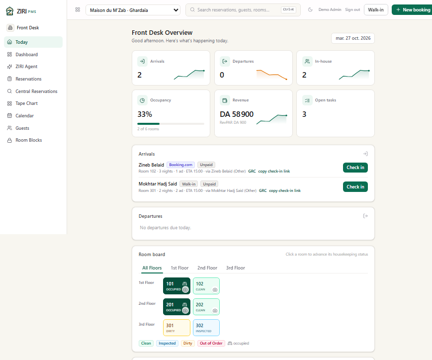
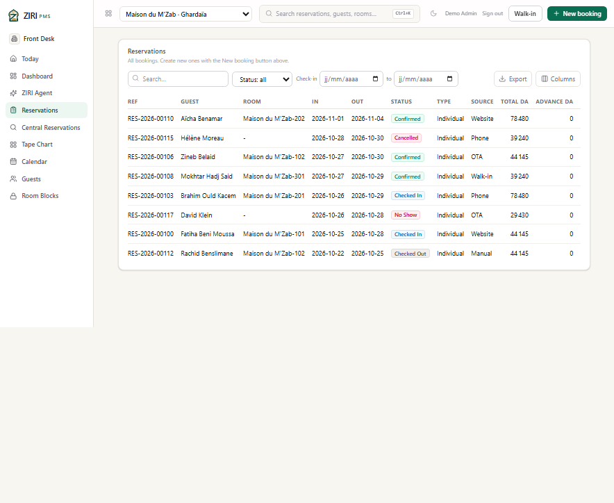
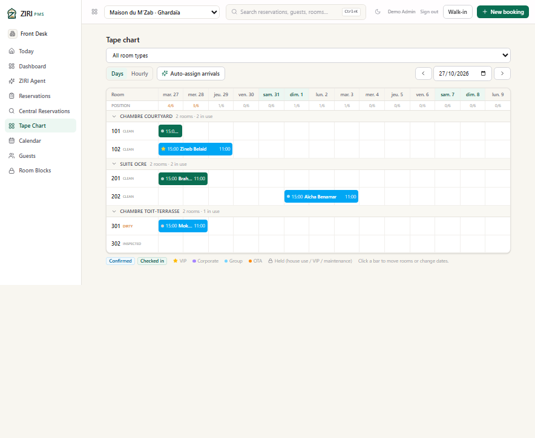
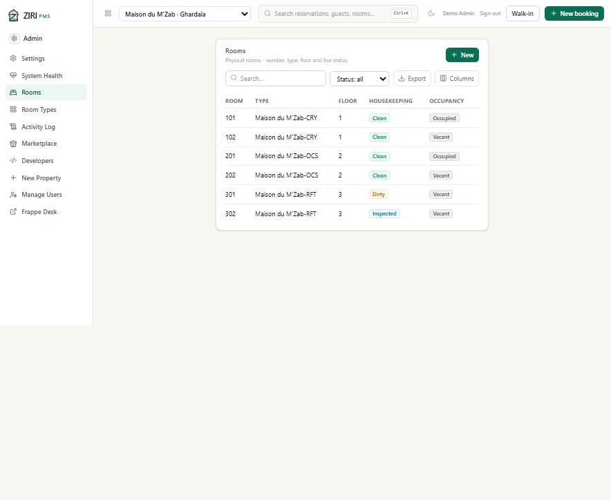
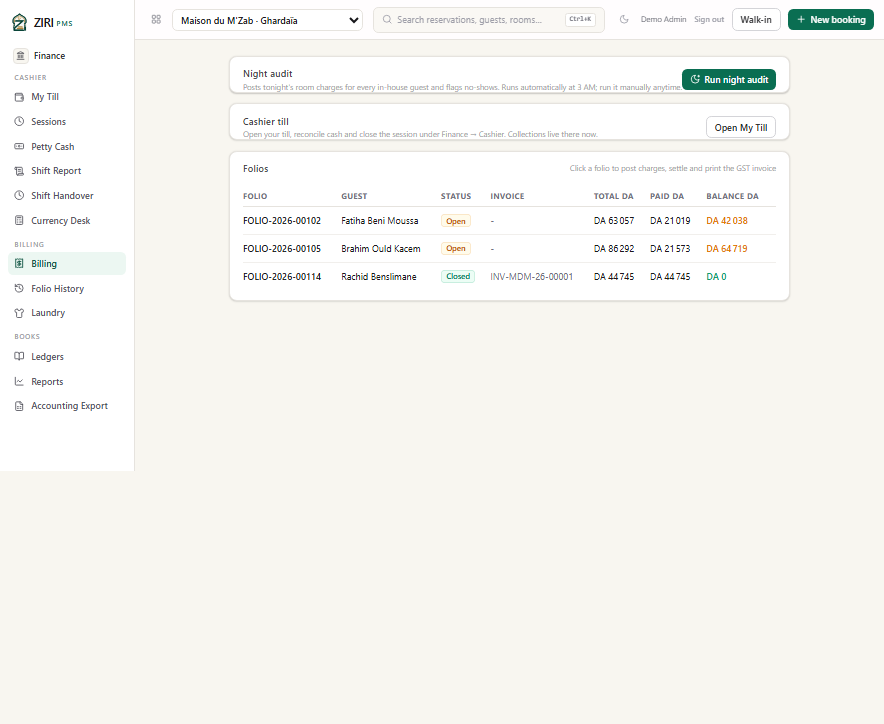

# Maison du M'Zab — Ghardaïa

> **Fictional demo scenario.** The property, its staff, guests, rates and
> reservations are synthetic. Email addresses use the reserved `.example`
> domain. No production data or real personal information is used.

**Profile:** guesthouse in ochre earth inside the M'Zab valley, a few steps
from the Beni Isguen ramparts, with a shaded courtyard, a roof terrace and
guided visits. **City:** Ghardaïa · **Currency:** DZD · **Demo inventory:** 6
rooms across 3 room types · **Demo data:** 8 guests, 8 reservations, 3 folios,
3 open housekeeping tasks.

This scenario is the smallest and most seasonal of the four. It shows that the
same PMS handles a courtyard guesthouse with distinctive room names, a low
base rate and a mostly leisure clientele.

*Today: 2 arrivals, 2 in-house guests, 33% occupancy, DA 58,900 posted revenue
and DA 900 RevPAR. The courtyard room and the Ocre suite are occupied; the
roof-terrace room is dirty before the walk-in arrival.*

## The scenario

**Zineb Belaid** arrives from Booking.com into room 102 for three nights.
**Mokhtar Hadj Said** walks in for two nights in room 301, the roof-terrace
room. **Fatiha Beni Moussa** (room 101, direct website) and **Brahim Ould
Kacem** (room 201, phone) are in house; Brahim's Ocre suite is the largest
folio of the day.

**Rachid Benslimane** checked out earlier in the week; his closed folio carries
invoice `INV-MDM-26-00001`. The mix of Algerian and European guests is
deliberate: this is a leisure guesthouse, not a business hotel.

## What the screenshots show

### Reservations

The eight stays include a three-night direct booking, a two-night OTA stay, a
walk-in and a cancelled phone booking. The list is the same operational view
the other properties use; only the inventory and rates change.

### Tape chart

Chambre Courtyard, Suite Ocre and Chambre Toit-Terrasse are separate groups.
Room 101 is occupied by Zineb, room 102 holds Aïcha Benamar's future booking,
room 201 is occupied by Brahim, and room 301 is the dirty walk-in room.

### Rooms

The room list keeps the guesthouse's physical reality visible: two occupied
rooms, two vacant and clean rooms, one dirty room and one inspected room. The
housekeeping state is independent of the reservation state.

### Billing

| Folio | Guest | Status | Total | Paid | Balance |
|---|---|---|---:|---:|---:|
| FOLIO-2026-00102 | Fatiha Beni Moussa | Open | DA 63,057 | DA 21,019 | DA 42,038 |
| FOLIO-2026-00105 | Brahim Ould Kacem | Open | DA 86,292 | DA 21,573 | DA 64,719 |
| FOLIO-2026-00114 | Rachid Benslimane | Closed | DA 44,745 | DA 44,745 | DA 0 |

The closed folio carries invoice `INV-MDM-26-00001`. The two open folios are
partially paid, which is the normal state mid-stay when a guest settles the
room portion before departure.

## Demo data in this property

| Room type | Code | Base rate / night | Rooms |
|---|---|---:|---:|
| Chambre Courtyard | CRY | DA 13,500 | 2 |
| Suite Ocre | OCS | DA 24,000 | 2 |
| Chambre Toit-Terrasse | RFT | DA 18,000 | 2 |

The property uses the same Algerian country pack: DZD, Africa/Algiers, French
locale, 9% GST, a DA 100 per-person per-night *taxe de séjour*, and a two-day
free cancellation window.

## Provenance

Captured on 27 October 2026 from the isolated staging deployment, signed in as
the seeded staging administrator. The four demo properties share one staging
database; production data was never read or copied. See
[all four scenarios](README.md) and the
[licensing notes](../algeria/LICENSING.md).
